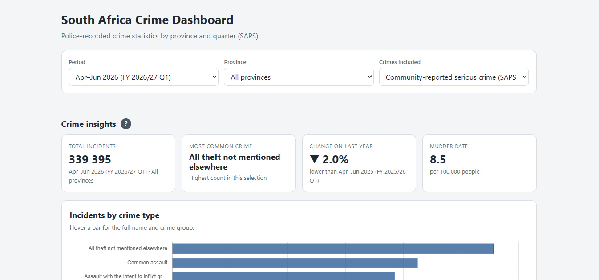

# SAPS Crime Dashboard

A Django web app that shows police-recorded crime in South Africa by province and quarter, built on the South African Police Service (SAPS) quarterly crime statistics.



**The headline figures match SAPS's own published numbers.** Totals avoid the double counting that happens when SAPS subtotals are added to the crimes they already contain (see [The double-counting bug](#the-double-counting-bug-and-the-fix)).

## Features

- Filter by period (six quarters), province and crime scope.
- Four headline cards: total incidents, most common crime, change on the same quarter last year, and murder rate per 100,000 people.
- Bar chart of incidents by crime type, and a year-on-year trend for the same season.
- Read-only JSON API with validated parameters and clean error responses.
- Data pipeline: cleaned CSV files, then a validated import into the database. Every SAPS subtotal is reconciled against its parts.
- 15 automated tests, including checks against SAPS's published figures.

## Tech stack

- Python 3.12+, Django 6.1, Django REST Framework
- SQLite
- django-environ for configuration
- Plain JavaScript with Chart.js 4.4.0 (bundled in the repo, no CDN)

## Quick start

Windows (PowerShell):

```powershell
git clone https://github.com/OratileElvis/crime-dashboard.git
cd crime-dashboard
python -m venv .venv
.venv\Scripts\Activate.ps1
python -m pip install -r requirements.txt
copy .env.example .env
```

macOS / Linux:

```bash
git clone https://github.com/OratileElvis/crime-dashboard.git
cd crime-dashboard
python3 -m venv .venv
source .venv/bin/activate
python -m pip install -r requirements.txt
cp .env.example .env
```

Open `.env` and replace `change-me` with a real secret key. Generate one with:

```
python -c "import secrets; print(secrets.token_urlsafe(50))"
```

Then build the database and start the server:

```
python manage.py migrate
python manage.py import_crime_stats
python manage.py runserver
```

Open http://127.0.0.1:8000/ for the dashboard. For the admin site at `/admin/`, first run `python manage.py createsuperuser`.

## Configuration

Settings are read from a `.env` file in the project root (never committed; `.env.example` shows the format).

| Variable | Purpose | Default |
|---|---|---|
| `DJANGO_SECRET_KEY` | Django secret key (required) | none: the app refuses to start without it |
| `DJANGO_DEBUG` | `True` for local development | `False` |
| `DJANGO_ALLOWED_HOSTS` | Comma-separated host names | empty |

## Data

The source of truth is the set of cleaned CSV files in `data/`:

| File | Contents |
|---|---|
| `saps_provincial_quarterly_clean.csv` | Incidents by province, crime category and quarter |
| `crime_category_map.csv` | Each category's parent, level and whether it counts in totals |
| `province_population.csv` | Population per province and year, for per-100,000 rates |
| `saps_provincial_monthly_clean.csv` | Monthly detail for April to June (not loaded yet) |

Six quarters are loaded: April to June for 2022 to 2026, plus July to September 2025. SAPS reports by financial year (April to March), so April to June is Q1. See `docs/data_quality_report.md` for the cleaning steps and the checks performed.

The database can be deleted and rebuilt at any time with `migrate` and `import_crime_stats`. The import is safe to re-run (it updates rather than duplicates), supports `--dry-run`, and cancels completely if any check fails.

## API

All endpoints are read-only `GET` requests.

| Endpoint | Returns |
|---|---|
| `/api/meta/` | Provinces and periods available, and the latest period |
| `/api/crime-summary/` | Incidents per crime type |
| `/api/crime-trends/` | Totals for the same quarter in each year |
| `/api/crime-insights/` | Total, most common crime, change on last year, murder rate |

Optional parameters: `province` (exact name), `period` (period id, defaults to the latest), and `scope` (`community`, the default, or `all`).

```
GET /api/crime-insights/?province=Gauteng
```

Bad input returns a clean error: `400` for an invalid value, `404` for an unknown province or period.

## The double-counting bug and the fix

The first version of this dashboard simply added up every row in the data. But SAPS publishes subtotals (for example "Contact crime", which is the sum of murder, rape, assault and more) alongside the individual crimes. For July to September 2025 the old code reported **935,923** incidents. Summing only the individual crimes gives **450,807**, so the dashboard overstated crime by about 2.07 times. Its "top crime" card also showed a subtotal instead of a real crime.

The fix:

- Every category now records its parent and a `counts_in_total` flag, so totals only add individual crimes.
- The default scope is SAPS's headline measure, the community-reported serious crimes. Crimes detected by police action (such as drug offences) rise when police search more, so they are optional.
- The importer checks that every subtotal equals the sum of its parts (432 checks across provinces and periods) and cancels the import on any mismatch.
- Tests pin the dashboard total to SAPS's published figure (339,395 for April to June 2026) and the murder rates to SAPS's published ratios.
- Trends compare the same quarter across years, because crime is seasonal.

## Project structure

```
crime-dashboard/
├── manage.py
├── requirements.txt
├── .env.example
├── crime_dashboard/            project settings and URLs
├── analytics/
│   ├── models.py               Province, Period, CrimeCategory, Population, CrimeRecord
│   ├── services.py             all database questions: totals, trends, rates
│   ├── views.py                dashboard page and API endpoints
│   ├── serializers.py          validates URL parameters
│   ├── urls.py, api_urls.py
│   ├── admin.py
│   ├── tests.py
│   ├── management/commands/import_crime_stats.py
│   ├── templates/analytics/dashboard.html
│   └── static/analytics/chart.umd.js
├── data/                       cleaned SAPS CSV files
└── docs/                       data quality report, screenshot
```

## Tests

```
python manage.py test analytics
```

The suite has 15 tests: nine on small hand-made data (no double counting, same-quarter comparisons, input validation) and six that load the real data and compare against SAPS's published figures.

## Limitations

- These are crimes recorded by police. Not all crime is reported.
- The murder rate uses SAPS's April to June population estimates, so it is approximate for other quarters (the API flags this).
- Only one July to September quarter is loaded, so that season has no year-on-year trend yet.
- The API is public and read-only, with no authentication or rate limiting. The app has not been deployed.

## Roadmap

- A script that turns each new SAPS workbook into the cleaned CSV files.
- A province comparison chart per 100,000 people.
- Continuous integration (tests, linting, security scanning) and a hosted demo.

## Data source

Crime statistics are published by the South African Police Service (SAPS) at saps.gov.za. Check SAPS's terms of use before redistributing the data files.

## Author

Built by [OratileElvis](https://github.com/OratileElvis).
